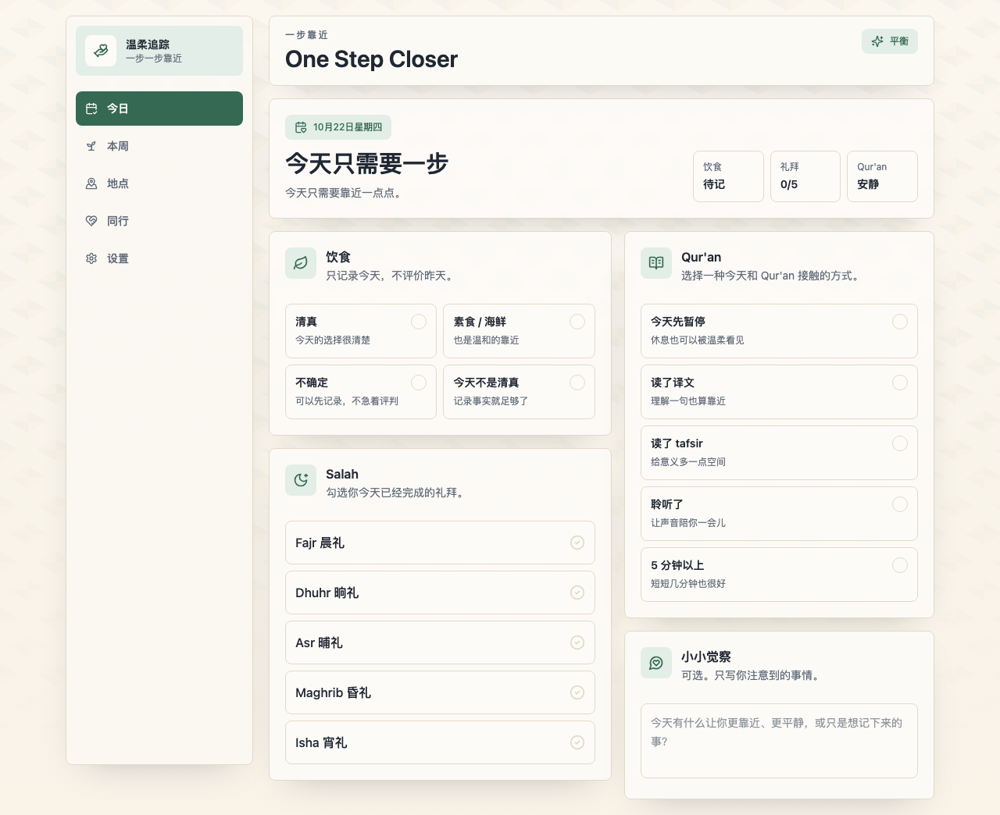

# One Step Closer · 一步靠近

[English](README.en.md)

一个以中文为主的穆斯林习惯记录应用，用简单的每日记录，留意饮食、礼拜和 Qur'an 阅读或聆听。界面保留温和、不责备的语气，记录只保存在当前浏览器中。

这是一个早期个人项目，使用 Next.js、React、TypeScript 和 Tailwind CSS 构建。欢迎提出可复现的问题、改进说明，或贡献范围清楚的小修改。



[查看手机宽度示例](docs/images/mobile.png)

## 当前功能

| 页面 | 可以做什么 |
| --- | --- |
| 今日 | 记录饮食选择、五次礼拜、Qur'an 接触方式和简短感想 |
| 本周 | 汇总当前周的饮食、礼拜和 Qur'an 记录 |
| 我的地点 | 手动保存地点、位置文字和备注，标记常去或想去 |
| Partner Mode | 在同一浏览器里记录两个人的名字、一个目标及完成状态 |
| 设置 | 修改显示名称、提醒文字、关注方向和主题；导出或恢复本地备份 |

地点页是个人收藏列表，不提供地图搜索或清真认证。Partner Mode 不会在两个人的设备之间共享记录；“每日提醒文字”仅显示在首页，不发送通知。饮食标签与周汇总是记录分类，不构成宗教判断。

## 本地运行

需要 Node.js 22 或以上，建议使用 Node.js 22 或 24，以及随 Node.js 提供的 npm。

从 GitHub 仓库的 **Code → Download ZIP** 下载并解压，或克隆仓库。在项目目录中运行：

```bash
npm ci
npm run dev
```

打开 [http://127.0.0.1:3000](http://127.0.0.1:3000)。不需要账户、API 密钥或环境变量。开发服务器默认只供本机访问。请一直使用同一个地址：`localhost` 与 `127.0.0.1` 的浏览器存储相互独立。

生产模式：

```bash
npm run build
npm start -- --hostname 127.0.0.1 --port 3001
```

生产预览打开 [http://127.0.0.1:3001](http://127.0.0.1:3001)。它使用不同端口，避免生产离线缓存遮住开发时的新代码；两个端口的记录互相独立。如果曾在开发地址启用生产缓存，只注销该地址的 service worker 并删除其 Cache Storage，保留 localStorage，不要清除全部网站数据。

部署时需要支持 Node.js 的 Next.js 托管环境。当前没有为 GitHub Pages 配置静态导出；把源码放到 GitHub 不会自动生成可访问的网站。

## 手机与离线使用

样式使用 Tailwind CSS 4，浏览器最低要求为 Safari 16.4、Chrome 111 或 Firefox 128。请优先使用仍在维护的浏览器版本。

读取记录与导出也需要安全上下文中的 Web Crypto，请使用 HTTPS 或本机 `http://127.0.0.1` 地址；不支持普通远程 HTTP 地址。保存和恢复还需要 Web Locks。不支持 Web Locks 的浏览器会进入只读模式；数据能够正常读取时仍可导出备份。

生产版本首次联网打开后，会预缓存五个页面及其构建资源；缓存完成后，可以离线打开这些页面。请先联网打开应用并等待缓存完成，再断网确认自己的浏览器能够正常打开和保存记录。仅生产模式注册 service worker。

手机安装到主屏幕通常需要 HTTPS。请使用浏览器提供的安装或“添加到主屏幕”入口；不同浏览器的入口和支持程度不同。离线功能请用生产模式检查，开发模式用于修改和预览。尚未完成 iOS 真机验证。

网站发布新版本后，需要先联网获取更新，再关闭该网站的全部标签页和已安装的 PWA 窗口，重新打开以启用新缓存。不要通过清除网站数据来更新：这会删除本地记录。

## 备份与恢复

在**设置 → 数据备份与恢复**中操作：

1. 点击**导出备份**，确认 JSON 文件已保存到自己信任的位置。文件包含每日记录、地点、伙伴信息和设置，未加密。
2. 恢复前，如需保留当前内容，先导出一份备份。点击**选择备份文件**，选择本应用导出的 JSON 文件（最大 2 MiB）。文件仅在浏览器内处理，不上传。
3. 核对备份与当前浏览器的记录天数、地点数量和日期范围。选择文件和查看预览不会修改记录；可点击**取消恢复**退出。
4. 勾选**我了解恢复会替换当前记录**，再点击**确认恢复**。恢复会一次替换全部四类数据，不会合并。预览后若记录发生变化，需要重新选择文件、查看预览。

格式不正确、版本不支持或文件过大时会停止操作。浏览器拒绝保存时保留原记录，不会只替换其中一类。请保留原备份文件；页面生成下载并不代表文件已经被你妥善保存。格式说明和虚构示例见 [备份格式](docs/backup-format.md)。

## 数据与当前限制

记录使用浏览器的 `localStorage` 保存，包括每日记录、地点、伙伴信息和设置。应用代码没有将这些记录上传到服务器，也没有接入统计追踪服务；托管平台仍可能保留普通网站访问日志。

- 没有账户或跨设备同步。可以手动导出、传送并恢复备份；更换浏览器、设备或网站地址不会自动带走记录。
- 出现“正在保存”时，请等待提示消失再刷新或关闭窗口。浏览器可能不显示离开提醒；强制关闭可能丢失尚未保存的更改。
- 清除网站数据可能删除全部记录。隐私浏览或浏览器存储不可用时，记录可能无法持久保存。
- 本地记录和导出的 JSON 文件均未加密。能访问同一浏览器资料或备份文件的人，可能看到记录。
- 旧版四个存储键会保留，首次成功编辑或恢复才写入新版快照。读取、导出和预览不会迁移数据。迁移需要额外存储空间；本地快照不能替代保存在浏览器之外的备份。
- 新版窗口之间协调写入。若仍打开的旧版窗口修改旧记录，应用会保留两份数据并暂停编辑；关闭旧窗口后联系维护者处理冲突，不要删除存储键。
- “本周”按设备本地日期、周一至周日汇总。伙伴目标保留到手动清空；完成勾选进入新周后会显示为未完成。

请使用虚构记录演示和报告问题，不要把自己的或他人的真实习惯记录、名字与地点上传到仓库。

## 检查与贡献

```bash
npx playwright install chromium
npm run check
```

首次运行浏览器测试需要安装 Chromium。`npm run check` 依次执行 lint、类型检查、构建工具兼容性测试、生产构建和浏览器回归测试。单独运行 `npm test` 前必须先完成 `npm run build`；`npm run test:e2e` 是同一测试命令的别名，无需重复执行。

更多开发约定见 [CONTRIBUTING.md](CONTRIBUTING.md)，安全问题见 [SECURITY.md](SECURITY.md)。提交问题时，说明浏览器、复现步骤、预期行为和实际结果即可。

2026-10-22 的完整依赖审计（包含开发工具）和运行依赖审计均为零通报。Tailwind 已升级到 4；Next.js 检查工具的旧目录匹配依赖使用一个有回归测试的小型兼容包替换。详情和复查命令见 [依赖审计记录](docs/dependency-audit.md)。维护者可从 [维护指南](docs/maintaining.md) 开始。

## 目录

| 位置 | 内容 |
| --- | --- |
| `src/app/`、`src/components/` | 五个页面、布局和共用界面 |
| `src/lib/` | 类型、日期、版本化本地存储与备份校验 |
| `src/service-worker.js` | 离线缓存逻辑的源码 |
| `scripts/build-service-worker.mjs` | 构建时生成缓存清单和 `public/sw.js`，生成文件不提交 |
| `public/` | PWA 清单、图标等静态文件 |
| `tests/` | 备份格式检查与浏览器回归测试 |
| `vendor/next-lint-glob/`、`scripts/tests/` | Next.js lint 目录匹配适配与回归测试 |

## 许可证

[MIT](LICENSE) · Copyright (c) 2026 Musa (musa426)。第三方依赖保留各自的许可证。
